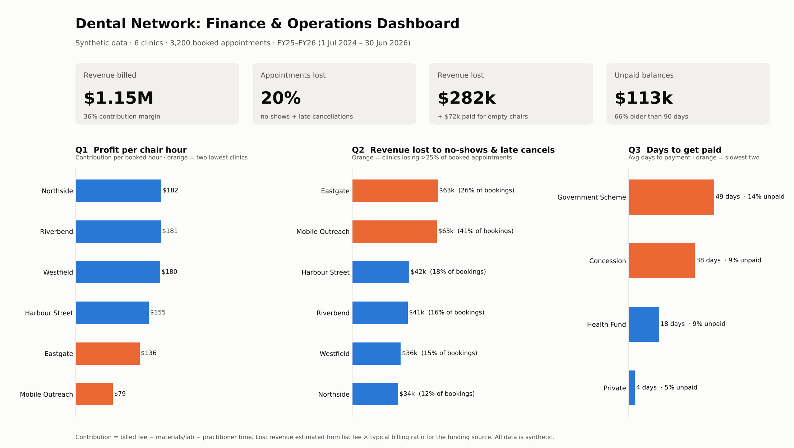

# Dental Network Finance & Operations Analysis

**Which clinics make money per chair hour, how much revenue is lost to empty chairs, and where is cash getting stuck?**

An end-to-end analysis of a *synthetic* six-clinic dental network (3,200 booked appointments, FY25–FY26), built with Python, SQL and Power BI/Tableau-ready tables. It mirrors the kind of finance and operations reporting I do day to day in healthcare: clinic profitability, appointment utilisation and debtor collections.



> **Note on data:** all data is computer-generated. No real clinic, patient, staff or financial information is used. Names such as "Northside" or "Eastgate" are invented. The patterns in the data were designed to resemble realistic dental operations, so the findings illustrate *method*, not real-world benchmarks.

---

## 1. The business problem

A multi-clinic dental group's management team wants to know:

1. **Profitability:** Which clinics and services earn the most for each hour a dental chair is booked?
2. **Utilisation:** How much revenue are no-shows and late cancellations costing, and where is it concentrated?
3. **Cash collection:** Which funding sources pay slowest, and how much money is sitting unpaid?

## 2. The data

One row per booked appointment (`data/raw/dental_appointments_raw.csv`, 3,264 rows before cleaning, 16 columns).

| Field group | Examples |
|---|---|
| Booking | `invoice_id`, `service_date`, `clinic`, `service_category`, `practitioner_type`, `appointment_status` |
| Money | `list_fee`, `billed_fee`, `materials_lab_cost`, `practitioner_cost` |
| Collections | `funding_source`, `payment_status`, `amount_paid`, `days_to_payment` |

Full column descriptions are in [`data/data_dictionary.md`](data/data_dictionary.md).

**Deliberately messy, as real exports are.** The raw file includes duplicate rows, test records, three different date formats, clinic names in mixed case or abbreviated, fees stored as text (`"$1,250.00"`), blank fields and impossible values. Every fix is logged in [`data/clean/cleaning_log.csv`](data/clean/cleaning_log.csv).

## 3. Method

| Step | Tool | File |
|---|---|---|
| Generate synthetic data | Python (pandas, NumPy) | `scripts/01_generate_data.py` |
| Clean and validate | Python (pandas) | `scripts/02_clean_data.py` |
| Answer the 3 questions | SQL (SQLite) | `sql/analysis_queries.sql` |
| Repeat in Python, build charts | pandas, matplotlib | `scripts/03_analysis_and_charts.py` |
| Dashboard | PNG charts and BI-ready tables | `dashboard/` |

**Key definitions**

- **Contribution** = billed fee − materials/lab cost − practitioner time cost. Practitioner time is still paid when a patient does not show.
- **Contribution per chair hour** = total contribution ÷ total *booked* chair hours, so empty chairs count against the clinic.
- **Revenue lost** = list fee × the typical billed-to-list ratio for that funding source, for every no-show or late cancellation.
- **Unpaid balance** = amount still owing on invoices marked *Outstanding* or *Part paid* at 30 June 2026.

**Cleaning summary (3,264 → 3,200 rows):** removed 4 test rows and 60 duplicates; standardised 1,120 dates, 684 clinic names, 150 category/funding labels; converted 256 text fees to numbers; set 8 negative payment days to blank; repaired 15 "Paid" rows with no paid amount; filled blank practitioner types and chair minutes from the typical value for the service; labelled 96 blank funding sources and 19 blank clinics "Unknown" rather than guessing.

## 4. Findings

**Network headline:** $1.15M billed, 36% contribution margin. 20% of booked appointments never produced revenue.

### Q1. Profit per chair hour

| Clinic | Contribution per chair hour |
|---|---|
| Northside | $182 |
| Riverbend | $181 |
| Westfield | $180 |
| Harbour Street | $155 |
| Eastgate | $136 |
| Mobile Outreach | $79 |

- Three clinics cluster at about $180 per hour. **Mobile Outreach earns less than half of that.**
- By service, **orthodontic ($338/hr) and cosmetic ($317/hr)** earn the most per hour. **Check-up & clean earns the least ($73/hr)** but has a healthy 40% margin and fills the diary, so it is a pipeline for higher-value work rather than a service to cut.

### Q2. Revenue lost to no-shows and late cancellations

- Estimated **$282k of revenue lost** over two years, plus **$72k** of practitioner time paid for empty chairs.
- **Eastgate (26% of bookings lost) and Mobile Outreach (41%)** account for 45% of lost revenue but only 29% of bookings.
- **Fridays (23%) and Mondays (21%)** are worst. Government-scheme and concession patients miss appointments more often (about 24–26% vs 18% for private and health-fund patients).

### Q3. Cash collection

| Funding source | Avg days to pay | Billed value unpaid |
|---|---|---|
| Government Scheme | 49 | 14% |
| Concession | 38 | 9% |
| Health Fund | 18 | 9% |
| Private | 4 | 5% |

- **$113k is currently owing, and 66% of it is more than 90 days old**, which is unlikely to be collected without action.
- **Westfield health-fund claims are unpaid at 16%**, well above the 3–10% at the other clinics, which suggests a claim submission or rejection problem at that site.

## 5. Recommendations

1. **Attack the diary at Eastgate and Mobile Outreach first.** Introduce SMS reminders with a confirm/cancel reply, and overbook modestly on Mondays and Fridays. *Illustrative scenario:* cutting both clinics to a 15% loss rate would recover about 150 appointments, roughly **$66k revenue over the two years** (about $33k a year), assuming recovered slots are filled at the average lost fee.
2. **Review the Mobile Outreach model.** At $79 per chair hour it needs a different mix (more orthodontic or restorative work, fewer low-yield bookings) or a minimum-booking rule.
3. **Start a debtor recovery routine.** Chase everything over 60 days, and set a policy for writing off or escalating balances over 90 days.
4. **Audit Westfield's health-fund claims** for rejection reasons before the unpaid balance grows.
5. **Protect the high-value services.** Prioritise chair time for orthodontic, cosmetic and crown work when scheduling.

## 6. Limitations

- The data is **synthetic**, so the findings demonstrate how I would approach the problem, not facts about any real organisation.
- Practitioner hourly rates ($80–$210) are my assumptions, and contribution excludes rent, admin and equipment.
- Lost revenue is an **estimate** based on typical billing ratios, not actual lost income.
- Recommendations assume recovered slots could be rebooked; real demand and patient behaviour would need testing, for example with a reminder pilot at one clinic.

## 7. How to reproduce

1. Install [Python](https://www.python.org/downloads/) and run `pip install pandas matplotlib`.
2. Run the three scripts in order from the project folder:

```
python scripts/01_generate_data.py
python scripts/02_clean_data.py
python scripts/03_analysis_and_charts.py
```

3. To run the SQL, open `data/clean/dental_ops.db` in [DB Browser for SQLite](https://sqlitebrowser.org/) and paste the queries from `sql/analysis_queries.sql`.
4. For Power BI or Tableau, import the CSV files in `dashboard/powerbi_tables/`.

## 8. Repository structure

```
dental-finance-ops-analysis/
├── README.md
├── requirements.txt
├── data/
│   ├── data_dictionary.md
│   ├── raw/dental_appointments_raw.csv
│   └── clean/ (clean CSV, cleaning_log.csv, dental_ops.db)
├── sql/analysis_queries.sql
├── scripts/ (01_generate_data.py, 02_clean_data.py, 03_analysis_and_charts.py)
└── dashboard/ (dashboard.png, chart1-3.png, powerbi_tables/)
```

**Author:** Jay Cruzanne Mandawe · www.linkedin.com/in/jay-cruz-mandawe

